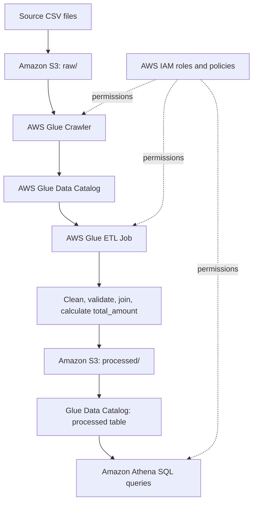

# AWS Workflow Explanation

This is the proposed AWS architecture for the assessment. The Python/Pandas output is already produced locally; the AWS section describes how the same source-to-target flow can be implemented in AWS.

## Workflow

1. **Amazon S3 – raw zone:** Upload `customers.csv`, `products.csv`, and `orders.csv` to an S3 bucket under a `raw/` prefix.
2. **AWS Glue Crawler:** Configure a crawler to read the raw CSV prefix and discover the file schemas.
3. **AWS Glue Data Catalog:** The crawler creates/updates database table metadata so Glue and Athena can understand the source data.
4. **AWS Glue ETL job:** Read the catalog tables, remove duplicate customer records, identify orders whose customer IDs do not exist, join valid orders to customer and product data, calculate `quantity * price`, and select the required output columns.
5. **Amazon S3 – processed zone:** Write the transformed result to a `processed/` prefix as CSV (or Parquet if the implementation is extended).
6. **AWS Glue Data Catalog:** Catalog the processed dataset so it can be queried.
7. **Amazon Athena:** Run SQL queries against the processed S3 data using the Glue Data Catalog metadata.
8. **AWS IAM:** Give the Glue crawler/job and Athena the minimum permissions needed to access only the relevant S3 locations and catalog resources. Keep S3 Block Public Access enabled; do not make the bucket public.

## Text workflow diagram

## Data quality rules

- Deduplicate customers using the customer record fields / customer ID.
- Keep orders only when their customer ID exists in the customer dataset.
- Preserve valid order statuses, including `Pending`.
- Calculate `total_amount = quantity * price`.
- Retain the required output columns: `order_id, customer_name, city, product_name, quantity, price, status, total_amount`.

**Implementation status:** This document describes the required AWS workflow. It does not claim that the AWS resources have already been created or executed.
