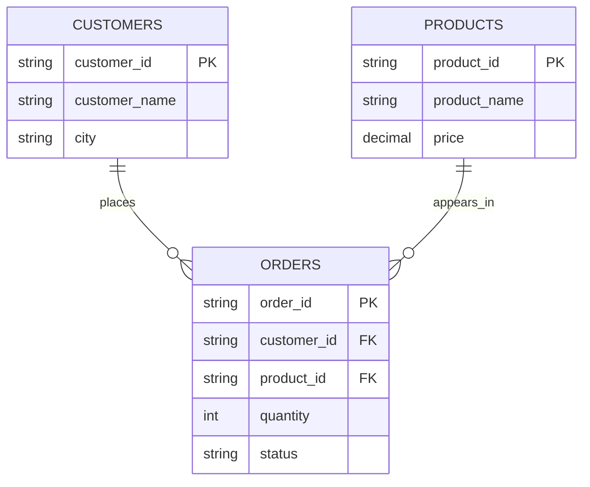

# Data Model

## Tables and grain

- **customers** (dimension): one row per unique customer. Primary key: `customer_id`.
- **products** (dimension): one row per product. Primary key: `product_id`.
- **orders** (fact): one row per individual order. Primary key: `order_id`.
  - `customer_id` is a foreign key to `customers.customer_id`.
  - `product_id` is a foreign key to `products.product_id`.

## Relationship diagram

## Grain and data quality

The grain of the `orders` fact table is one row per order. The supplied customer file contains a duplicate C101 record; the Python process removes the duplicate. Order O105 refers to customer C105, which is absent from the customer file, so it is identified as invalid and excluded from the final joined output and relational `orders` table.
